# Model Data Logikal (ERD) — SISDATA

> Dijana secara automatik oleh `php artisan pro:jana-dokumen-data` daripada skema pangkalan data `myds_laravel_test_pro` pada 24/10/2026 15:16. Jangan sunting dengan tangan — jana semula.

Entiti teras SRS §4.1 berpusat pada `lot_tanah` (ADR-01): setiap rekod satelit memegang `lot_id`. Kardinaliti dibaca daripada kunci asing: `||--o{` satu-ke-banyak, `|o--o{` FK boleh null, `||--||` FK unik.

## 1. Teras hartanah (lot_tanah dan satelit)

```mermaid
erDiagram
    lot_tanah |o--o{ aduan : "lot_id"
    sesi_import ||--o{ baris_import : "id_sesi"
    lot_tanah ||--o{ cukai : "lot_id"
    lot_tanah ||--o{ data_spatial : "lot_id"
    kes_mahkamah ||--o{ kes_mahkamah_lot : "kes_mahkamah_id"
    lot_tanah ||--o{ kes_mahkamah_lot : "lot_id"
    lot_tanah ||--o{ kontrak_pajakan : "lot_id"
    lot_tanah ||--o{ log_akses_profil : "lot_id"
    lot_tanah ||--o{ penilaian : "lot_id"
    sesi_import ||--o{ ralat_import : "id_sesi"
    daftar_stewardship_data |o--o{ tugasan_kualiti_data : "id_stewardship"
    aduan {
        uuid id PK
        uuid lot_id FK
        character_varying kategori
        date tarikh_aduan
        character_varying status
        bigint id_pegawai FK
        text tindakan_susulan
        character_varying klasifikasi
        timestamp_without_time_zone created_at
        timestamp_without_time_zone updated_at
        timestamp_without_time_zone deleted_at
        geometry koordinat
    }
    lot_tanah {
        uuid id PK
        character_varying no_lot
        character_varying kod_mukim
        character_varying kod_daerah
        character_varying kod_negeri
        numeric keluasan
        character_varying unit_keluasan
        character_varying kategori_guna_tanah
        character_varying zoning
        text syarat_nyata
        character_varying bahagian_pemilik
        character_varying status_lot
        character_varying klasifikasi
        bigint id_data_owner FK
        bigint id_data_steward FK
        integer versi_rekod
        timestamp_without_time_zone created_at
        timestamp_without_time_zone updated_at
        timestamp_without_time_zone deleted_at
        geometry koordinat_pusat
        character_varying no_lot_normal
        boolean sintetik
        character_varying sumber_sistem
        character_varying fail_asal
        character_varying kunci_asal
        uuid id_migrasi_larian
        uuid id_sesi_import
        uuid id_lot_gabung
        character_varying status_sebelum_arkib
        timestamp_without_time_zone diarkib_pada
        jsonb tag
        text catatan
        bigint id_pencipta FK
    }
    baris_import {
        bigint id PK
        uuid id_sesi FK,UK
        integer no_baris UK
        jsonb data
        character_varying status
        character_varying id_rekod
        timestamp_without_time_zone created_at
        timestamp_without_time_zone updated_at
    }
    sesi_import {
        uuid id PK
        character_varying entiti_sasaran
        character_varying nama_fail
        character_varying format_fail
        bigint id_pengguna FK
        jsonb pemetaan
        jsonb lajur_fail
        integer bil_baris_dibaca
        integer bil_sah
        integer bil_berjaya
        integer bil_ditolak
        integer bil_diabaikan
        character_varying lokasi_fail_asal
        character_varying catatan_fail_asal
        character_varying status_sesi
        timestamp_without_time_zone tarikh_komit
        timestamp_without_time_zone created_at
        timestamp_without_time_zone updated_at
    }
    cukai {
        uuid id PK
        uuid lot_id FK
        character_varying jenis
        character_varying no_bil
        numeric jumlah
        date tarikh_akhir
        character_varying status_bayaran
        character_varying kaedah_bayaran
        character_varying klasifikasi
        timestamp_without_time_zone created_at
        timestamp_without_time_zone updated_at
        timestamp_without_time_zone deleted_at
    }
    data_spatial {
        bigint id PK
        uuid lot_id FK
        integer srid_asal
        numeric keluasan_dikira
        character_varying sumber_data
        character_varying rujukan_fail_sumber
        date tarikh_perolehan_data
        character_varying status_pengesahan
        bigint id_pegawai_pengesah FK
        timestamp_without_time_zone tarikh_pengesahan
        text catatan_pertindihan
        boolean semasa
        timestamp_without_time_zone created_at
        timestamp_without_time_zone updated_at
        geometry geometri
        integer versi
        character_varying format_asal
        character_varying id_dokumen_sumber
        numeric peratus_beza_keluasan
        bigint id_pemuat_naik FK
        text catatan_pengesahan
        character_varying sumber_sistem
        character_varying kunci_asal
    }
    kes_mahkamah_lot {
        uuid kes_mahkamah_id FK,PK
        uuid lot_id FK,PK
    }
    kes_mahkamah {
        uuid id PK
        character_varying no_kes
        character_varying jenis
        character_varying mahkamah
        character_varying status
        numeric kos_guaman
        character_varying klasifikasi
        timestamp_without_time_zone created_at
        timestamp_without_time_zone updated_at
        timestamp_without_time_zone deleted_at
    }
    kontrak_pajakan {
        uuid id PK
        uuid lot_id FK
        character_varying penyewa
        date tarikh_mula
        date tarikh_tamat
        numeric kadar
        numeric deposit
        text terma
        character_varying status
        character_varying klasifikasi
        timestamp_without_time_zone created_at
        timestamp_without_time_zone updated_at
        timestamp_without_time_zone deleted_at
    }
    log_akses_profil {
        bigint id PK
        uuid lot_id FK
        bigint id_pengguna FK
        character_varying jenis_capaian
        character_varying saluran
        character_varying alamat_ip
        jsonb butiran
        timestamp_without_time_zone tarikh_masa
    }
    penilaian {
        uuid id PK
        uuid lot_id FK
        date tarikh_penilaian
        numeric nilai_pasaran
        numeric nilai_setara
        character_varying kaedah
        character_varying penilai
        integer versi
        character_varying klasifikasi
        timestamp_without_time_zone created_at
        timestamp_without_time_zone updated_at
        timestamp_without_time_zone deleted_at
    }
    ralat_import {
        bigint id PK
        uuid id_sesi FK
        integer no_baris
        character_varying medan
        text nilai_diberi
        character_varying kod_ralat
        character_varying sebab_penolakan
    }
    tugasan_kualiti_data {
        bigint id PK
        character_varying entiti
        character_varying id_rekod
        character_varying kod_isu
        text keterangan
        character_varying tahap_keterukan
        bigint id_stewardship FK
        bigint id_data_steward FK
        character_varying kod_daerah
        character_varying status
        text tindakan_pembetulan
        bigint diselesaikan_oleh FK
        timestamp_without_time_zone diselesaikan_pada
        character_varying sumber
        timestamp_without_time_zone created_at
        timestamp_without_time_zone updated_at
    }
    daftar_stewardship_data {
        bigint id PK
        character_varying komponen_data
        character_varying entiti_berkaitan
        character_varying jawatan_data_owner
        character_varying bahagian_data_owner
        bigint id_data_owner FK
        character_varying jawatan_data_steward
        character_varying bahagian_data_steward
        bigint id_data_steward FK
        character_varying bahagian_pemilik
        character_varying kod_daerah
        text peranan_tanggungjawab
        date tarikh_berkuat_kuasa
        character_varying status
        timestamp_without_time_zone created_at
        timestamp_without_time_zone updated_at
    }
```



## 2. Keseluruhan skema (semua modul)

Atribut ditunjukkan bagi kunci sahaja supaya rajah kekal boleh dibaca.

```mermaid
erDiagram
    users |o--o{ adm_indeks_carian : "dikemas_kini_oleh"
    users |o--o{ adm_integrasi : "dikemas_kini_oleh"
    users |o--o{ adm_kod_rujukan : "dikemas_kini_oleh"
    users |o--o{ adm_kod_rujukan_sejarah : "diubah_oleh"
    adm_kod_rujukan ||--o{ adm_kod_rujukan_sejarah : "id_kod_rujukan"
    users |o--o{ adm_konfig_kelulusan : "id_pelulus"
    users ||--o{ adm_konfig_kelulusan : "id_pemohon"
    users |o--o{ adm_parameter : "dikemas_kini_oleh"
    users |o--o{ adm_rahsia : "dikemas_kini_oleh"
    users |o--o{ adm_sinonim_carian : "dikemas_kini_oleh"
    users |o--o{ adm_templat : "dikemas_kini_oleh"
    users |o--o{ adm_templat_versi : "dicipta_oleh"
    adm_templat ||--o{ adm_templat_versi : "id_templat"
    users |o--o{ adm_tugasan_berjadual : "dikemas_kini_oleh"
    users |o--o{ adm_tugasan_larian : "id_pengguna"
    adm_tugasan_berjadual ||--o{ adm_tugasan_larian : "id_tugasan"
    users |o--o{ aduan : "id_pegawai"
    lot_tanah |o--o{ aduan : "lot_id"
    users |o--o{ amaran_keselamatan : "disemak_oleh"
    users |o--o{ amaran_keselamatan : "user_id"
    sesi_import ||--o{ baris_import : "id_sesi"
    users |o--o{ cadangan_duplikasi : "id_data_steward"
    lot_tanah ||--o{ cukai : "lot_id"
    users |o--o{ daftar_stewardship_data : "id_data_owner"
    users |o--o{ daftar_stewardship_data : "id_data_steward"
    users |o--o{ data_spatial : "id_pegawai_pengesah"
    users |o--o{ data_spatial : "id_pemuat_naik"
    lot_tanah ||--o{ data_spatial : "lot_id"
    users |o--o{ dokumen : "id_pencipta"
    dokumen_kategori ||--o{ dokumen : "kategori_id"
    users |o--o{ dokumen : "pemilik_proses_id"
    users |o--o{ dokumen_arkib : "diarkib_oleh"
    dokumen ||--o{ dokumen_arkib : "dokumen_id"
    dokumen |o--o{ dokumen_imbasan : "dokumen_id"
    dokumen_kuarantin |o--o{ dokumen_imbasan : "kuarantin_id"
    users |o--o{ dokumen_kebenaran : "diberi_oleh"
    dokumen ||--o{ dokumen_kebenaran : "dokumen_id"
    users |o--o{ dokumen_kuarantin : "dimuat_naik_oleh"
    dokumen_kategori |o--o{ dokumen_medan_metadata : "kategori_id"
    users |o--o{ dokumen_pelupusan : "dimohon_oleh"
    dokumen ||--o{ dokumen_pelupusan : "dokumen_id"
    users |o--o{ dokumen_versi : "dimuat_naik_oleh"
    dokumen ||--o{ dokumen_versi : "dokumen_id"
    users |o--o{ jadual_retensi : "id_pelulus"
    users ||--o{ kata_laluan_sejarah : "user_id"
    kes_mahkamah ||--o{ kes_mahkamah_lot : "kes_mahkamah_id"
    lot_tanah ||--o{ kes_mahkamah_lot : "lot_id"
    lot_tanah ||--o{ kontrak_pajakan : "lot_id"
    users |o--o{ kunci_api_pro : "dibatalkan_oleh"
    users ||--o{ kunci_api_pro : "id_pemilik"
    users |o--o{ log_akses_profil : "id_pengguna"
    lot_tanah ||--o{ log_akses_profil : "lot_id"
    users |o--o{ log_log_masuk : "user_id"
    users |o--o{ lot_tanah : "id_data_owner"
    users |o--o{ lot_tanah : "id_data_steward"
    users |o--o{ lot_tanah : "id_pencipta"
    ntf_mesej |o--o{ ntf_eskalasi_log : "mesej_eskalasi_id"
    ntf_mesej ||--o{ ntf_eskalasi_log : "mesej_id"
    users |o--o{ ntf_eskalasi_log : "penerima_asal_id"
    users |o--o{ ntf_eskalasi_log : "penyelia_id"
    ntf_status_pengguna |o--o{ ntf_eskalasi_log : "status_pengguna_id"
    ntf_jenis ||--o{ ntf_keutamaan_pengguna : "jenis_id"
    users ||--o{ ntf_keutamaan_pengguna : "pengguna_id"
    users |o--o{ ntf_mesej : "dicipta_oleh"
    ntf_jenis ||--o{ ntf_mesej : "jenis_id"
    ntf_templat |o--o{ ntf_mesej : "templat_id"
    ntf_jenis ||--o{ ntf_penerima_peraturan : "jenis_id"
    ntf_mesej ||--o{ ntf_penghantaran : "mesej_id"
    users |o--o{ ntf_penghantaran : "penerima_id"
    ntf_mesej ||--o{ ntf_status_pengguna : "mesej_id"
    users ||--o{ ntf_status_pengguna : "pengguna_id"
    users |o--o{ ntf_templat : "dicipta_oleh"
    ntf_jenis ||--o{ ntf_templat : "jenis_id"
    users |o--o{ pemetaan_import : "id_pencipta"
    peranan |o--o{ pemetaan_tuntutan : "peranan_id"
    users |o--o{ pengguna_peranan : "diberi_oleh"
    peranan ||--o{ pengguna_peranan : "peranan_id"
    users ||--o{ pengguna_peranan : "user_id"
    users ||--o{ pengguna_skop : "user_id"
    lot_tanah ||--o{ penilaian : "lot_id"
    peranan ||--o{ peranan_kebenaran : "peranan_id"
    peranan ||--o{ peranan_skop : "peranan_id"
    users |o--o{ polisi_keselamatan : "dikemas_kini_oleh"
    sesi_import ||--o{ ralat_import : "id_sesi"
    users |o--o{ recert_keputusan : "disemak_oleh"
    recert_kitaran ||--o{ recert_keputusan : "kitaran_id"
    peranan ||--o{ recert_keputusan : "peranan_id"
    users ||--o{ recert_keputusan : "user_id"
    users |o--o{ recert_kitaran : "dicipta_oleh"
    jadual_retensi |o--o{ rekod_arkib : "id_jadual_retensi"
    users |o--o{ rekod_arkib : "id_pelulus_arkib"
    users |o--o{ rekod_arkib : "id_pemohon"
    users |o--o{ rekod_arkib : "id_pemulih"
    users |o--o{ sesi : "ditamatkan_oleh"
    users ||--o{ sesi : "user_id"
    users |o--o{ sesi_import : "id_pengguna"
    migrasi_larian ||--o{ staging_hak_milik : "migrasi_larian_id"
    staging_lot_tanah ||--o{ staging_hak_milik : "staging_lot_tanah_id"
    migrasi_larian ||--o{ staging_lot_tanah : "migrasi_larian_id"
    migrasi_larian ||--o{ staging_pemilik : "migrasi_larian_id"
    staging_hak_milik ||--o{ staging_pemilik : "staging_hak_milik_id"
    users |o--o{ status_akaun_log : "dilakukan_oleh"
    users ||--o{ status_akaun_log : "user_id"
    users |o--o{ tugasan_kualiti_data : "diselesaikan_oleh"
    users |o--o{ tugasan_kualiti_data : "id_data_steward"
    daftar_stewardship_data |o--o{ tugasan_kualiti_data : "id_stewardship"
    users |o--o{ versi_rekod_induk : "id_pengesah_kedua"
    users |o--o{ versi_rekod_induk : "id_pengguna"
    users |o--o{ wf_definisi : "diluluskan_oleh"
    users |o--o{ wf_definisi : "diminta_aktif_oleh"
    wf_definisi |o--o{ wf_definisi : "id_asal"
    users |o--o{ wf_definisi : "id_pencipta"
    wf_definisi ||--o{ wf_definisi_log : "id_definisi"
    users |o--o{ wf_definisi_log : "id_pengguna"
    wf_peringkat ||--o{ wf_eskalasi : "id_peringkat"
    wf_tugasan ||--o{ wf_eskalasi_log : "id_tugasan"
    wf_definisi ||--o{ wf_instans : "id_definisi"
    users ||--o{ wf_instans : "id_pemohon"
    wf_peringkat |o--o{ wf_instans : "peringkat_semasa"
    wf_kumpulan ||--o{ wf_kumpulan_ahli : "id_kumpulan"
    users ||--o{ wf_kumpulan_ahli : "id_pengguna"
    wf_peringkat ||--o{ wf_pelulus : "id_peringkat"
    users |o--o{ wf_pemangku : "dicipta_oleh"
    users ||--o{ wf_pemangku : "id_pemangku"
    users ||--o{ wf_pemangku : "id_pengguna"
    wf_definisi ||--o{ wf_peralihan : "id_definisi"
    wf_definisi ||--o{ wf_peringkat : "id_definisi"
    users ||--o{ wf_pindah_versi : "diminta_oleh"
    users |o--o{ wf_pindah_versi : "diputuskan_oleh"
    wf_definisi ||--o{ wf_pindah_versi : "id_definisi_asal"
    wf_definisi ||--o{ wf_pindah_versi : "id_definisi_baru"
    wf_instans ||--o{ wf_pindah_versi : "id_instans"
    users |o--o{ wf_sejarah : "id_bagi_pihak"
    wf_instans ||--o{ wf_sejarah : "id_instans"
    users |o--o{ wf_sejarah : "id_pengguna"
    wf_peringkat |o--o{ wf_sejarah : "id_peringkat"
    wf_tugasan |o--o{ wf_sejarah : "id_tugasan"
    wf_definisi ||--o{ wf_susulan : "id_definisi"
    wf_peralihan ||--o{ wf_syarat : "id_peralihan"
    users |o--o{ wf_tugasan : "diselesaikan_oleh"
    wf_instans ||--o{ wf_tugasan : "id_instans"
    wf_pelulus |o--o{ wf_tugasan : "id_pelulus"
    users |o--o{ wf_tugasan : "id_pelulus_asal"
    wf_peringkat |o--o{ wf_tugasan : "id_peringkat"
    adm_indeks_carian {
        bigint id PK
        character_varying entiti UK
        bigint dikemas_kini_oleh FK
    }
    adm_integrasi {
        bigint id PK
        character_varying kod UK
        bigint dikemas_kini_oleh FK
    }
    adm_kesihatan {
        bigint id PK
    }
    adm_kod_rujukan {
        bigint id PK
        character_varying jenis_kod UK
        character_varying kod UK
        bigint dikemas_kini_oleh FK
    }
    adm_kod_rujukan_sejarah {
        bigint id PK
        bigint id_kod_rujukan FK,UK
        integer versi UK
        bigint diubah_oleh FK
    }
    adm_konfig_kelulusan {
        bigint id PK
        bigint id_pemohon FK
        bigint id_pelulus FK
    }
    adm_log_integrasi {
        bigint id PK
    }
    adm_log_ralat {
        bigint id PK
    }
    adm_parameter {
        bigint id PK
        character_varying kunci UK
        bigint dikemas_kini_oleh FK
    }
    adm_rahsia {
        bigint id PK
        character_varying kunci UK
        bigint dikemas_kini_oleh FK
    }
    adm_sinonim_carian {
        bigint id PK
        character_varying istilah UK
        bigint dikemas_kini_oleh FK
    }
    adm_templat {
        bigint id PK
        character_varying kod UK
        bigint dikemas_kini_oleh FK
    }
    adm_templat_versi {
        bigint id PK
        bigint id_templat FK,UK
        integer versi UK
        bigint dicipta_oleh FK
    }
    adm_tugasan_berjadual {
        bigint id PK
        character_varying kod UK
        character_varying kunci_sistem UK
        bigint dikemas_kini_oleh FK
    }
    adm_tugasan_larian {
        bigint id PK
        bigint id_tugasan FK
        bigint id_pengguna FK
    }
    aduan {
        uuid id PK
        uuid lot_id FK
        bigint id_pegawai FK
    }
    amaran_keselamatan {
        bigint id PK
        bigint user_id FK
        bigint disemak_oleh FK
    }
    audit_arkib {
        bigint id PK
        bigint no_urutan UK
        character cincangan_rekod UK
    }
    audit_eksport {
        bigint id PK
    }
    audit_integriti_semakan {
        bigint id PK
    }
    audit_perubahan_medan {
        bigint id PK
    }
    audit_rekod {
        bigint id PK
        bigint no_urutan UK
        character cincangan_rekod UK
    }
    audit_retensi_polisi {
        bigint id PK
    }
    baris_import {
        bigint id PK
        uuid id_sesi FK,UK
        integer no_baris UK
    }
    cadangan_duplikasi {
        bigint id PK
        character_varying entiti UK
        uuid id_rekod_a UK
        uuid id_rekod_b UK
        bigint id_data_steward FK
    }
    cukai {
        uuid id PK
        uuid lot_id FK
    }
    daftar_stewardship_data {
        bigint id PK
        bigint id_data_owner FK
        bigint id_data_steward FK
    }
    data_spatial {
        bigint id PK
        uuid lot_id FK
        bigint id_pegawai_pengesah FK
        bigint id_pemuat_naik FK
    }
    dokumen {
        uuid id PK
        character_varying no_rujukan UK
        bigint kategori_id FK
        bigint pemilik_proses_id FK
        bigint id_pencipta FK
    }
    dokumen_arkib {
        bigint id PK
        uuid dokumen_id FK
        bigint diarkib_oleh FK
    }
    dokumen_imbasan {
        bigint id PK
        uuid dokumen_id FK
        bigint kuarantin_id FK
    }
    dokumen_kategori {
        bigint id PK
        character_varying kod UK
    }
    dokumen_kebenaran {
        bigint id PK
        uuid dokumen_id FK,UK
        character_varying jenis_penerima UK
        character_varying penerima UK
        bigint diberi_oleh FK
    }
    dokumen_kuarantin {
        bigint id PK
        bigint dimuat_naik_oleh FK
    }
    dokumen_medan_metadata {
        bigint id PK
        bigint kategori_id FK,UK
        character_varying kod UK
    }
    dokumen_pelupusan {
        bigint id PK
        uuid dokumen_id FK
        bigint dimohon_oleh FK
    }
    dokumen_versi {
        bigint id PK
        uuid dokumen_id FK,UK
        integer no_versi UK
        bigint dimuat_naik_oleh FK
    }
    jadual_retensi {
        bigint id PK
        character_varying kategori_rekod UK
        bigint id_pelulus FK
    }
    kamus_data {
        bigint id PK
        character_varying nama_jadual UK
        character_varying nama_medan UK
    }
    kata_laluan_sejarah {
        bigint id PK
        bigint user_id FK
    }
    kebenaran {
        character_varying kunci PK
    }
    kes_mahkamah {
        uuid id PK
    }
    kes_mahkamah_lot {
        uuid kes_mahkamah_id FK,PK
        uuid lot_id FK,PK
    }
    klasifikasi_data {
        bigint id PK
        character_varying komponen_data UK
    }
    kontrak_pajakan {
        uuid id PK
        uuid lot_id FK
    }
    kunci_api_pro {
        bigint id PK
        bigint id_token UK
        bigint id_pemilik FK
        bigint dibatalkan_oleh FK
    }
    log_akses_profil {
        bigint id PK
        uuid lot_id FK
        bigint id_pengguna FK
    }
    log_log_masuk {
        bigint id PK
        bigint user_id FK
    }
    log_penggunaan_api {
        bigint id PK
    }
    lot_tanah {
        uuid id PK
        bigint id_data_owner FK
        bigint id_data_steward FK
        bigint id_pencipta FK
    }
    migrasi_larian {
        uuid id PK
    }
    notifications {
        uuid id PK
    }
    ntf_eskalasi_log {
        bigint id PK
        bigint status_pengguna_id FK
        bigint mesej_id FK
        bigint penerima_asal_id FK
        bigint penyelia_id FK
        bigint mesej_eskalasi_id FK
    }
    ntf_jenis {
        bigint id PK
        character_varying kod UK
    }
    ntf_keutamaan_pengguna {
        bigint id PK
        bigint pengguna_id FK,UK
        bigint jenis_id FK,UK
    }
    ntf_mesej {
        bigint id PK
        bigint jenis_id FK
        bigint templat_id FK
        bigint dicipta_oleh FK
    }
    ntf_penerima_peraturan {
        bigint id PK
        bigint jenis_id FK,UK
        character_varying sasaran UK
        character_varying nilai UK
    }
    ntf_penghantaran {
        bigint id PK
        bigint mesej_id FK
        bigint penerima_id FK
    }
    ntf_status_pengguna {
        bigint id PK
        bigint mesej_id FK,UK
        bigint pengguna_id FK,UK
    }
    ntf_templat {
        bigint id PK
        bigint jenis_id FK,UK
        integer versi UK
        bigint dicipta_oleh FK
    }
    pemetaan_import {
        bigint id PK
        character_varying entiti_sasaran UK
        character_varying nama UK
        bigint id_pencipta FK
    }
    pemetaan_tuntutan {
        bigint id PK
        bigint peranan_id FK
    }
    pengguna_peranan {
        bigint id PK
        bigint user_id FK,UK
        bigint peranan_id FK,UK
        bigint diberi_oleh FK
    }
    pengguna_skop {
        bigint id PK
        bigint user_id FK,UK
        character_varying jenis_skop UK
        character_varying nilai_skop UK
    }
    penilaian {
        uuid id PK
        uuid lot_id FK
    }
    peranan {
        bigint id PK
        character_varying kod UK
    }
    peranan_kebenaran {
        bigint id PK
        bigint peranan_id FK,UK
        character_varying kebenaran UK
    }
    peranan_skop {
        bigint id PK
        bigint peranan_id FK,UK
        character_varying jenis_skop UK
        character_varying nilai_skop UK
    }
    peraturan_kualiti_data {
        bigint id PK
    }
    polisi_keselamatan {
        character_varying kunci PK
        bigint dikemas_kini_oleh FK
    }
    ralat_import {
        bigint id PK
        uuid id_sesi FK
    }
    recert_keputusan {
        bigint id PK
        bigint kitaran_id FK,UK
        bigint user_id FK,UK
        bigint peranan_id FK,UK
        bigint disemak_oleh FK
    }
    recert_kitaran {
        bigint id PK
        bigint dicipta_oleh FK
    }
    ref_daerah {
        bigint id PK
        character_varying kod UK
        integer versi UK
    }
    ref_jenis_dokumen {
        bigint id PK
        character_varying kod UK
        integer versi UK
    }
    ref_jenis_hak_milik {
        bigint id PK
        character_varying kod UK
        integer versi UK
    }
    ref_kategori_aduan {
        bigint id PK
        character_varying kod UK
        integer versi UK
    }
    ref_kategori_guna_tanah {
        bigint id PK
        character_varying kod UK
        integer versi UK
    }
    ref_klasifikasi_data {
        bigint id PK
        character_varying kod UK
        integer versi UK
    }
    ref_mukim {
        bigint id PK
        character_varying kod UK
        integer versi UK
    }
    ref_negeri {
        bigint id PK
        character_varying kod UK
        integer versi UK
    }
    ref_pbt {
        bigint id PK
        character_varying kod UK
        integer versi UK
    }
    ref_sempadan {
        bigint id PK
        character_varying jenis UK
        character_varying kod UK
    }
    ref_tempat_ibadat {
        bigint id PK
        character_varying osm_jenis UK
        bigint osm_id UK
    }
    rekod_arkib {
        uuid id PK
        bigint id_jadual_retensi FK
        bigint id_pemohon FK
        bigint id_pelulus_arkib FK
        bigint id_pemulih FK
    }
    sesi {
        uuid id PK
        bigint user_id FK
        bigint ditamatkan_oleh FK
    }
    sesi_import {
        uuid id PK
        bigint id_pengguna FK
    }
    settings {
        bigint id PK
        character_varying key UK
    }
    staging_hak_milik {
        uuid id PK
        uuid migrasi_larian_id FK
        uuid staging_lot_tanah_id FK
        character_varying sumber_sistem UK
        character_varying fail_asal UK
        character_varying kunci_asal UK
    }
    staging_lot_tanah {
        uuid id PK
        uuid migrasi_larian_id FK
        character_varying sumber_sistem UK
        character_varying fail_asal UK
        character_varying kunci_asal UK
    }
    staging_pemilik {
        uuid id PK
        uuid migrasi_larian_id FK
        uuid staging_hak_milik_id FK
        character_varying sumber_sistem UK
        character_varying fail_asal UK
        character_varying kunci_asal UK
    }
    status_akaun_log {
        bigint id PK
        bigint user_id FK
        bigint dilakukan_oleh FK
    }
    tugasan_kualiti_data {
        bigint id PK
        bigint id_stewardship FK
        bigint id_data_steward FK
        bigint diselesaikan_oleh FK
    }
    users {
        bigint id PK
        character_varying email UK
        character_varying oidc_sub UK
    }
    versi_rekod_induk {
        uuid id PK
        character_varying entiti UK
        character_varying id_rekod UK
        integer no_versi UK
        bigint id_pengguna FK
        bigint id_pengesah_kedua FK
    }
    wf_cuti_umum {
        bigint id PK
        date tarikh UK
        character_varying nama UK
        character_varying negeri UK
    }
    wf_definisi {
        bigint id PK
        character_varying kod_aliran UK
        integer no_versi UK
        bigint id_pencipta FK
        bigint id_asal FK
        bigint diminta_aktif_oleh FK
        bigint diluluskan_oleh FK
    }
    wf_definisi_log {
        bigint id PK
        bigint id_definisi FK
        bigint id_pengguna FK
    }
    wf_eskalasi {
        bigint id PK
        bigint id_peringkat FK
    }
    wf_eskalasi_log {
        bigint id PK
        bigint id_tugasan FK
    }
    wf_instans {
        uuid id PK
        bigint id_definisi FK
        bigint id_pemohon FK
        bigint peringkat_semasa FK
    }
    wf_kumpulan {
        bigint id PK
        character_varying kod UK
    }
    wf_kumpulan_ahli {
        bigint id_kumpulan FK,PK
        bigint id_pengguna FK,PK
    }
    wf_pelulus {
        bigint id PK
        bigint id_peringkat FK
    }
    wf_pemangku {
        bigint id PK
        bigint id_pengguna FK
        bigint id_pemangku FK
        bigint dicipta_oleh FK
    }
    wf_peralihan {
        bigint id PK
        bigint id_definisi FK
    }
    wf_peringkat {
        bigint id PK
        bigint id_definisi FK,UK
        character_varying kod UK
    }
    wf_pindah_versi {
        bigint id PK
        uuid id_instans FK
        bigint id_definisi_asal FK
        bigint id_definisi_baru FK
        bigint diminta_oleh FK
        bigint diputuskan_oleh FK
    }
    wf_sejarah {
        bigint id PK
        uuid id_instans FK
        bigint id_tugasan FK
        bigint id_peringkat FK
        bigint id_pengguna FK
        bigint id_bagi_pihak FK
    }
    wf_susulan {
        bigint id PK
        bigint id_definisi FK
    }
    wf_syarat {
        bigint id PK
        bigint id_peralihan FK
    }
    wf_tugasan {
        bigint id PK
        uuid id_instans FK
        bigint id_peringkat FK
        bigint id_pelulus FK
        bigint id_pelulus_asal FK
        bigint diselesaikan_oleh FK
    }
```

